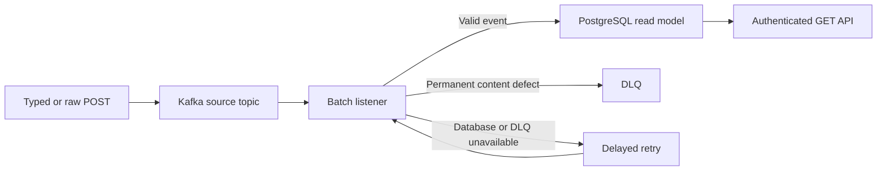

# Fund order event processing

Java 21 / Spring Boot application for a fictional investment-fund trading partner. It accepts order status events over HTTP, publishes their JSON text to Kafka, consumes Kafka records in batches, and exposes successfully processed events from PostgreSQL. Invalid Kafka content goes to a dead-letter topic (DLQ). `REJECTED` is a valid business status and is stored normally.

## Run locally

Prerequisites: Docker with Compose. The first build downloads Java images and Maven dependencies.

```bash
cp .env.example .env
docker compose up --build -d
docker compose ps
curl -fsS http://localhost:8080/actuator/health/readiness
```

The sample credentials in `.env.example` are for local use only. Change both passwords before sharing the stack. Compose exposes the app on `localhost:8080` and Kafka on `localhost:9092`; PostgreSQL stays on the Compose network. The app creates the source and DLQ topics with three partitions each and Flyway creates the database table. To stop the stack, run `docker compose down`. `docker compose down -v` also removes PostgreSQL data.

## Try the two publication paths

The typed endpoint validates before sending. A valid order status event:

```bash
curl -i -u analyst:change-this-local-password \
  -H 'Content-Type: application/json' \
  -d '{"schemaVersion":1,"eventId":"f46d8666-dd70-439d-a8f8-9c797ed3cc4d","orderId":"7d9b4d48-8967-4b6b-ad60-a15104115757","partnerCode":"AGENCY_A","fundIsin":"LU1234567890","status":"REJECTED","occurredAt":"2026-10-21T12:00:00Z"}' \
  http://localhost:8080/api/v1/fund-order-events
```

The response is `202 Accepted` after Kafka acknowledges the record. Processing is asynchronous, so the event may appear in the read API a moment later:

```bash
curl -u analyst:change-this-local-password \
  http://localhost:8080/api/v1/fund-order-events/f46d8666-dd70-439d-a8f8-9c797ed3cc4d
curl -u analyst:change-this-local-password \
  'http://localhost:8080/api/v1/fund-order-events?page=0&size=20'
```

The raw endpoint accepts `text/plain` unchanged. This command gets `202` because Kafka accepts the text; the batch consumer then finds invalid JSON and publishes the original value to the DLQ:

```bash
curl -i -u analyst:change-this-local-password \
  -H 'Content-Type: text/plain' --data-binary 'not-json' \
  http://localhost:8080/api/v1/fund-order-events/raw
docker compose exec kafka /opt/kafka/bin/kafka-console-consumer.sh \
  --bootstrap-server kafka:19092 --topic fund-order-events.DLQ \
  --from-beginning --max-messages 1
```

A typed request with an unknown status gets `400` and never enters Kafka. Sending the same invalid JSON as raw text gets `202` first, then the consumer routes it to the DLQ. Raw **valid** JSON is processed and stored. Both POST endpoints require Basic authentication. The raw endpoint rejects bodies over 64 KiB with `413` before publishing to Kafka.

## What the consumer does



| Case | Result |
| --- | --- |
| `ACCEPTED`, `REJECTED`, or `EXECUTED` event | Stored and returned by GET. |
| Malformed JSON, missing required field, unsupported schema version, bad enum/format, or conflicting reuse of `eventId` | Original Kafka record goes to DLQ without futile content retries. |
| Identical replay of an `eventId` | No extra database row. |
| PostgreSQL or unexpected application failure | Retried with a delay; failed offset remains pending. |
| DLQ publication failure | Source record remains pending for recovery retry. |

The listener receives up to `APP_KAFKA_MAX_POLL_RECORDS` records per poll and stops at the exact failed record. Spring Kafka commits successful earlier offsets, recovers one permanent failure to the DLQ, and redelivers later records. Actual batch size depends on available records and broker fetches; it is not guaranteed to equal the maximum. Typed events use `orderId` as their Kafka key, preserving per-order partition ordering. Raw text uses a generated key because it may not contain an `orderId`.

Delivery across Kafka and PostgreSQL is **at least once**. The JPA repository reads the persisted events; one native PostgreSQL `INSERT ... ON CONFLICT DO NOTHING` query makes event storage idempotent under concurrent delivery. A reused `eventId` with different content goes to the DLQ. There is no cross-system exactly-once transaction. The event schema is intentionally small and fictional: the ISIN rule checks basic format, not instrument existence or banking compliance.

## Configuration and deployment

All broker, topic, group, concurrency, retry, send timeout, and maximum poll settings are in [application.yml](src/main/resources/application.yml), with environment overrides shown in [.env.example](.env.example). Basic credentials must be supplied through `APP_BASIC_AUTH_USERNAME` and `APP_BASIC_AUTH_PASSWORD`; the app rejects blank values at startup. Use HTTPS at an ingress outside local development.

[SecurityConfiguration.java](src/main/java/com/example/fundorders/security/SecurityConfiguration.java) is the documented authentication extension point. To adopt JWT, replace its HTTP Basic and in-memory user beans with Spring Security OAuth2 resource-server configuration, validate issuer/audience and authorities, and keep the controller contracts unchanged. JWT is not implemented in this submission.

The [Kubernetes example](deploy/kubernetes/deployment.yaml) includes startup, readiness, and liveness probes. Liveness checks the process; readiness also checks PostgreSQL. Supply the referenced `fund-orders-config` ConfigMap and `fund-orders-secrets` Secret, use a built image, and provision Kafka topics with matching source/DLQ partition counts. On a managed broker that restricts topic creation, pre-provision them and set `spring.kafka.admin.auto-create=false` in deployment configuration. Configure TLS and broker credentials for nonlocal Kafka.

HTTP is documented in [OpenAPI](docs/api/openapi.yaml); Kafka topics, messages, and DLQ headers are documented in [AsyncAPI](docs/api/asyncapi.yaml). These are separate contracts because REST request validation and asynchronous consumer validation have different outcomes.

## Test and coverage

With Java 21 and Docker running:

```bash
./mvnw verify
```

The test suite includes unit tests for conversion, producer behavior, batch failure identification, security, pagination, and database idempotency. Testcontainers integration tests use real Kafka and PostgreSQL to exercise HTTP publish → Kafka batch consume → authenticated read or DLQ. A controlled batch integration test preloads three records before listener startup and asserts the actual multi-record delivery, database results, DLQ metadata, and broker-committed offsets. A second scenario injects a failed DLQ send, verifies that the invalid record and following record remain pending, then allows a real DLQ publication and verifies recovery. This fault injection tests the publication boundary; it does not simulate a broker outage. Maven Failsafe runs `*IT` classes during `verify`. JaCoCo produces `target/site/jacoco/index.html` and `target/site/jacoco/jacoco.xml`; a generated snapshot is included at [codex/reports/coverage/index.html](codex/reports/coverage/index.html). No hosted CI is required for the local verification gate.

## Interview discussion points

- Explain why a `400` typed request never reaches the DLQ, while invalid raw text can.
- Walk through a valid–invalid–valid batch and which offsets are committed or redelivered.
- Explain why `REJECTED` is business data, not a processing exception.
- Show how `eventId` prevents duplicate rows and why this is at-least-once processing.
- Describe how a database outage or DLQ send failure preserves the failed source record.
- Discuss partition ordering, schema evolution, JWT replacement, and production topic/secret management.
